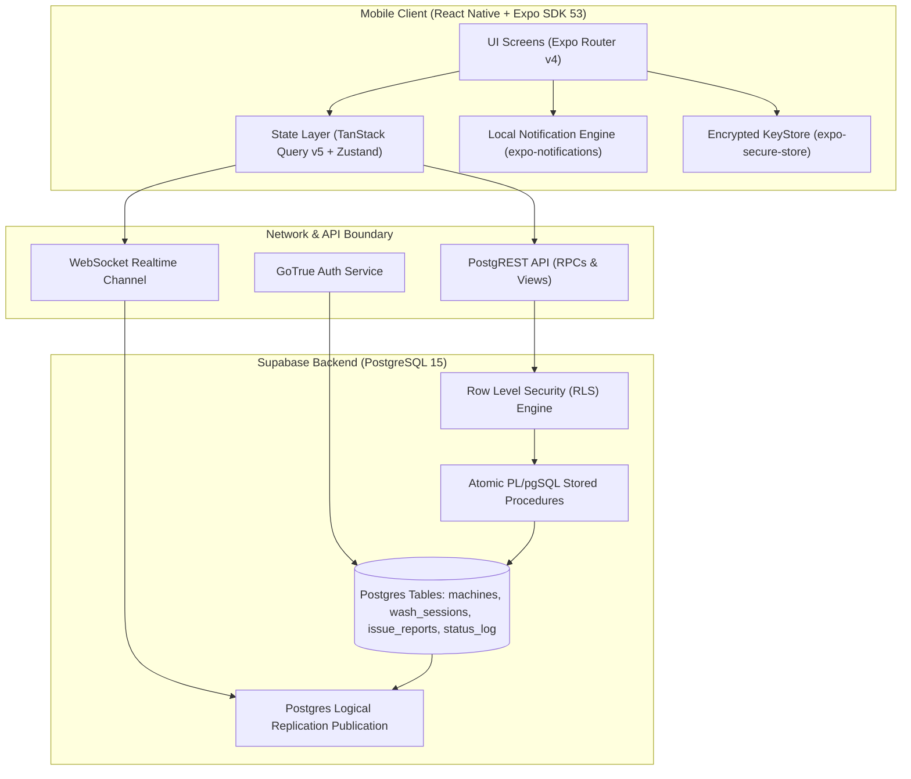
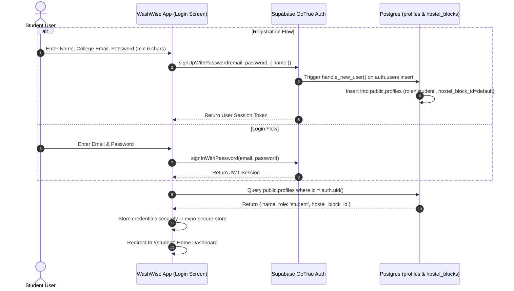
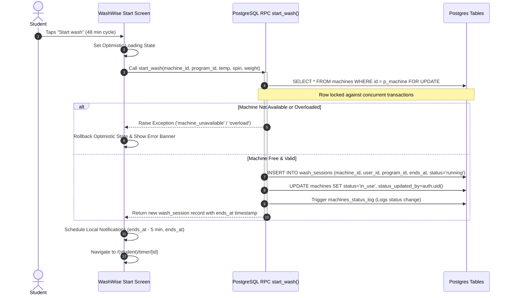
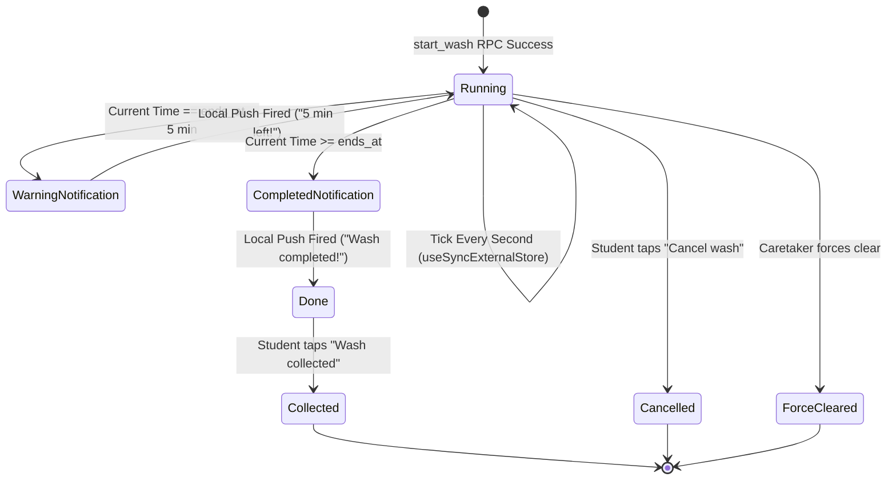
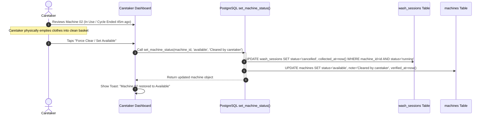
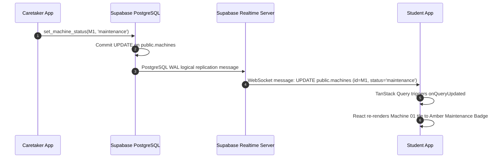
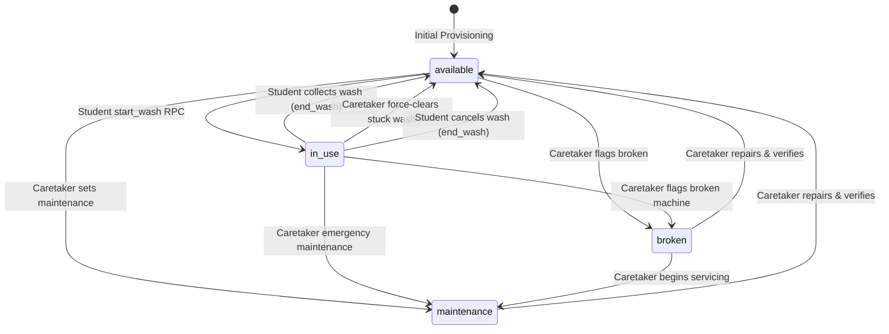
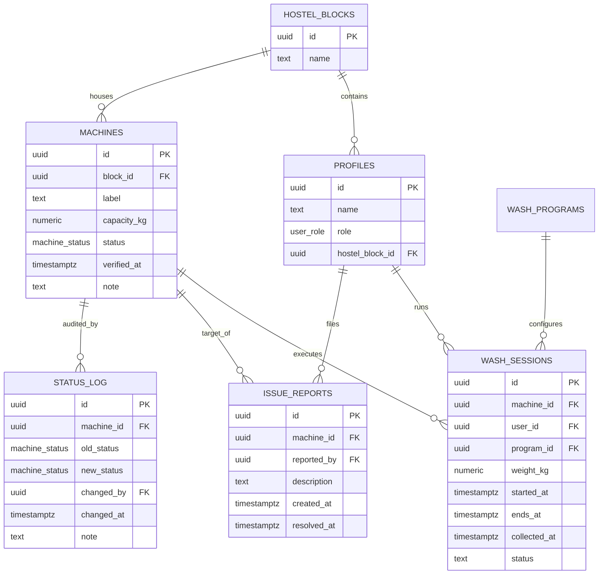

# WashWise — Application Workflows & Functional Specification

> **Comprehensive System Workflows, Feature Lifecycles, Business Logic, and Architectural Flowcharts for WashWise.**
> *Designed for university hostel laundry operations to eliminate wait times, optimize machine utilization, and provide transparent operational maintenance.*

---

## Table of Contents
1. [Executive Summary & Problem Domain](#1-executive-summary--problem-domain)
2. [High-Level System Architecture](#2-high-level-system-architecture)
3. [User Roles & Security Permissions](#3-user-roles--security-permissions)
4. [Authentication & Onboarding Workflows](#4-authentication--onboarding-workflows)
   - 4.1 Student Sign-up & Sign-in Flow
   - 4.2 Caretaker Sign-in & Authentication Flow
   - 4.3 Route Guard & Session Hydration
5. [Student Feature Workflows](#5-student-feature-workflows)
   - 5.1 Real-Time Laundry Room Discovery
   - 5.2 Wash Program Selection & Parameter Customization
   - 5.3 Mathematical Duration Calculation & Overload Guard
   - 5.4 Atomic Machine Reservation (`start_wash`)
   - 5.5 Live Wash Countdown & Notification Lifecycle
   - 5.6 Laundry Collection & Machine Release
   - 5.7 Emergency / Early Wash Cancellation
   - 5.8 Machine Issue & Fault Reporting
6. [Caretaker Feature Workflows](#6-caretaker-feature-workflows)
   - 6.1 Daily Inspection & Machine Status Verification
   - 6.2 Manual State Transitions (Maintenance / Out of Order)
   - 6.3 Force-Clearing Abandoned or Stuck Machines
   - 6.4 Issue Ticket Triage & Resolution Workflow
   - 6.5 Machine Audit Trail & Historical Log Inspection
7. [System-Level & Backend Workflows](#7-system-level--backend-workflows)
   - 7.1 Concurrency & Double-Booking Prevention Mechanics
   - 7.2 Realtime Event Propagation (Database to Mobile Device)
   - 7.3 Push & Local Notification Scheduling Pipeline
   - 7.4 Offline Resilience & Graceful Fallback System
8. [Entity Relationship & State Transition Models](#8-entity-relationship--state-transition-models)
9. [Summary Table for Project Reports](#9-summary-table-for-project-reports)

---

## 1. Executive Summary & Problem Domain

### 1.1 The Hostel Laundry Problem
In university residential halls, communal laundry facilities suffer from significant operational friction:
* **The "Ghost Walk":** Students haul heavy laundry hampers down multiple flights of stairs only to discover all machines occupied or broken.
* **Inaccurate Timers:** Standard machine cycle displays rarely reflect actual cycle durations when wash weight, water temperature, or spin cycles are adjusted.
* **Abandoned Laundry Bottleneck:** Completed cycles frequently sit in locked or idle drums for hours because students forget to collect their clothes, preventing others from washing.
* **Slow Maintenance Response:** When a machine breaks down, students leave verbal or sticky-note complaints that take days to reach maintenance personnel.

### 1.2 The WashWise Solution
**WashWise** is a utilitarian mobile utility engineered to streamline hostel laundry operations:
1. **Live Visibility:** Real-time digital board showing free, in-use, and broken machines in the student's assigned hostel block.
2. **Accurate Duration Engine:** Algorithmic calculation factoring in program selection, water temperature, spin intensity, and garment weight.
3. **Atomic Booking:** Stored database procedures preventing race conditions and double-booking.
4. **Automated Reminders:** Smart local notifications triggered before and upon wash completion.
5. **Caretaker Maintenance Suite:** Dedicated interface for hostel caretakers to stamp machine health, force-clear abandoned drums, and resolve student maintenance tickets.

---

## 2. High-Level System Architecture

WashWise leverages a cloud-synchronized, reactive architecture built on **React Native (Expo Managed)** and **Supabase (PostgreSQL + Auth + Realtime Engine)**.



---

## 3. User Roles & Security Permissions

The system operates under strict **Row Level Security (RLS)** in PostgreSQL. User roles are validated on every database transaction using the `public.is_caretaker()` function.

| Feature / Action | Student Role | Caretaker Role | Guest / Unauthenticated |
|---|:---:|:---:|:---:|
| View Laundry Board in Assigned Block | Yes | Yes | No |
| Configure & Start Wash Cycle | Yes | No | No |
| Track Active Personal Wash Timer | Yes | No | No |
| Mark Wash as Collected | Yes | No (uses Force-Clear) | No |
| Cancel Active Wash Cycle | Yes | No | No |
| Submit Machine Issue Report | Yes | No | No |
| Verify Machine Physical State | No | Yes | No |
| Set Machine to Maintenance / Broken | No | Yes | No |
| Force-Clear Abandoned Machine | No | Yes | No |
| View Machine Audit / Transition Logs | No | Yes | No |
| Triage & Resolve Issue Tickets | No | Yes | No |

---

## 4. Authentication & Onboarding Workflows

### 4.1 Student Sign-up & Sign-in Flow

Students authenticate via email and password restricted to the university domain. Upon registration, an automated PostgreSQL database trigger initializes their profile and assigns them to their default hostel block.



### 4.2 Caretaker Sign-in & Authentication Flow

Caretakers utilize pre-provisioned administrative accounts assigned to specific residential blocks. The mobile application includes a one-tap autofill utility for swift demonstration and testing.

1. Caretaker switches to the **Caretaker** tab on `/(auth)/login`.
2. Caretaker enters username (e.g., `username_1`) and secure password.
3. The app automatically qualifies the username to the internal identity domain (`username_1@washwise.app`).
4. Supabase validates the credentials and resolves the profile.
5. The `role === 'caretaker'` claim is verified, routing the user to `/(caretaker)`.

### 4.3 Route Guard & Session Hydration

The `useProtectedRoute` hook evaluates the application routing state upon startup:
* **Token Expired / Missing:** Redirect to `/(auth)/login`.
* **Authenticated as Student attempting Caretaker screen:** Blocked and redirected to `/(student)`.
* **Authenticated as Caretaker attempting Student screen:** Blocked and redirected to `/(caretaker)`.

---

## 5. Student Feature Workflows

### 5.1 Real-Time Laundry Room Discovery

Students open the app to monitor the operational state of washing machines in their assigned block without physically traveling to the laundry room.

```mermaid
flowchart TD
    Start([Open WashWise App]) --> CheckAuth{Is Student Logged In?}
    CheckAuth -- No --> LoginScreen[Redirect to Login]
    CheckAuth -- Yes --> LoadHome[Load /(student)/index.tsx]

    LoadHome --> QueryBoard[(Query public.machine_board)]
    QueryBoard --> RenderGrid[Render 2-Column Machine Grid]
    RenderGrid --> SummaryBar["Display 'X of Y Free' Summary Bar"]

    RenderGrid --> CheckRunning{Has Active Running Session?}
    CheckRunning -- Yes --> ActiveBanner[Render Sticky Active Wash Banner]
    CheckRunning -- No --> ListenRealtime[Subscribe to Supabase Realtime Channel]

    ListenRealtime --> OnEvent{Change Detected?}
    OnEvent -- Status Updated --> InvalidateCache[Invalidate TanStack Query]
    InvalidateCache --> RenderGrid
```

#### Tile Display States:
* **Available (Green `#1E9E6A`):** Displays machine number (e.g., `01`), capacity (e.g., `7.0 kg`), and active "Available" badge. Tapping opens the Start Wash configuration screen.
* **In Use (Sky Blue `#3B9AD9`):** Displays time remaining countdown and dynamic horizontal progress bar indicating cycle completion percentage.
* **Maintenance (Amber `#C98A1B`):** Machine under repair or calibration. Card is non-interactive with descriptive note.
* **Broken (Red `#CF4B4B`):** Machine decommissioned. Visually dimmed with strike-through icon; displays caretaker maintenance note.

---

### 5.2 Wash Program Selection & Parameter Customization

When an available machine is tapped, the student transitions to the `/start` configuration workflow. The student configures four key wash parameters:

1. **Wash Program:**
   * **Eco:** 35 minutes base duration (water & energy saving).
   * **Normal:** 45 minutes base duration (standard cottons and mixed loads).
   * **Heavy:** 60 minutes base duration (denims, towels, bedding).
   * **Delicates:** 30 minutes base duration (gentle wash for synthetic/fragile fabrics).
2. **Water Temperature:**
   * `Cold`: +0 minutes (no water heating required).
   * `30°C`: +4 minutes (mild heating).
   * `40°C`: +8 minutes (standard hygiene temperature).
   * `60°C`: +15 minutes (deep sanitization).
3. **Spin Speed:**
   * `Low`: +0 minutes.
   * `Medium`: +2 minutes.
   * `High`: +5 minutes.
4. **Fabric Load Weight:**
   * Controlled via an interactive stepper (increments of 0.5 kg to 1.0 kg).
   * Range: 1.0 kg up to the machine's rated capacity (typically 7.0 kg or 8.0 kg).

---

### 5.3 Mathematical Duration Calculation & Overload Guard

All timer calculations execute through a deterministic mathematical model defined in `src/lib/timer.ts`. The exact same formula is validated both in client preview and in the server-side RPC.

#### Mathematical Model:
$$\text{Total Wash Duration (minutes)} = T_{\text{base}}(\text{program}) + \Delta T(\text{temp}) + \Delta T(\text{spin}) + \Delta T(\text{load})$$

Where:
$$\Delta T(\text{load}) = \left\lceil \max(\text{weight} - 1.0, 0) \times R_{\text{per\_kg}} \right\rceil$$

* $R_{\text{per\_kg}} = 2.0\text{ minutes/kg}$

#### Overload Safety Rule:
$$\text{If } \text{weight} > \text{machine.capacity\_kg} \implies \text{Status} = \text{INVALID}$$

If an overload condition is triggered:
* The load capacity bar turns alert red.
* An inline warning states: *"Overload: Max capacity is X.0 kg"*.
* The **Start wash** button is disabled, preventing motor strain and cycle failure.

---

### 5.4 Atomic Machine Reservation (`start_wash`)

To prevent race conditions where two students attempt to book the same available machine simultaneously, the reservation executes via a PostgreSQL stored procedure with row-level locks.



---

### 5.5 Live Wash Countdown & Notification Lifecycle

Once the cycle starts, the student views a real-time progress screen driven by server-authoritative timestamps (`ends_at`).



#### Key Technical Highlights:
1. **Zero Client Clock Drift:** The countdown calculation is based on `ends_at - Date.now()`. If the user leaves the app or restarts their phone, the timer recalculates accurately against server time.
2. **Circular Progress Ring:** An SVG ring renders the percentage of elapsed time against total cycle duration.
3. **Monospace Tabular Figures:** Displayed in **JetBrains Mono** font to prevent visual text shifting as numbers decrement.

---

### 5.6 Laundry Collection & Machine Release

When the wash finishes (or while in progress), the student walks to the laundry room, retrieves their clothes, and presses **"Wash collected"**.

1. The app invokes the stored procedure `end_wash(session_id, 'collected')`.
2. The database updates `wash_sessions.status = 'collected'` and timestamps `collected_at = now()`.
3. The machine's status flips back to `available`.
4. All scheduled local notifications for this session are pruned via `cancelScheduledNotificationAsync`.
5. The student is returned to the home dashboard.

---

### 5.7 Emergency / Early Wash Cancellation

If a student needs to retrieve laundry early or made an error in program selection:
1. Student taps **"Cancel wash"** on the timer screen.
2. An alert modal asks for confirmation to prevent accidental taps.
3. Upon confirmation, the app executes `end_wash(session_id, 'cancelled')`.
4. Machine is immediately freed back to `available` and the audit log records the cancellation.

---

### 5.8 Machine Issue & Fault Reporting

If a student notices a leaking pipe, drum rattle, or display error:
1. Student taps **"Report issue"** on the timer screen or machine detail.
2. An input sheet appears requesting a short description (3 to 500 characters).
3. The app invokes `report_issue(machine_id, description)`.
4. The ticket is immediately inserted into `issue_reports` and routed into the Caretaker's triage dashboard.

---

## 6. Caretaker Feature Workflows

### 6.1 Daily Inspection & Machine Status Verification

Caretakers conduct physical inspection rounds in the hostel laundry rooms. The Caretaker Home view is optimized for rapid scanning and one-touch status stamping.

```mermaid
flowchart TD
    OpenCaretaker[Caretaker Opens App] --> ListMachines[List Machines in Assigned Block]
    ListMachines --> InspectPhysical[Physically Inspect Machine]
    
    InspectPhysical --> Decision{Is Machine Working & Clean?}
    
    Decision -- Yes, Everything OK --> TapVerify[Tap 'Verify Machine']
    TapVerify --> RPCVerify[Execute verify_machine RPC]
    RPCVerify --> StampTime[Update verified_at = NOW()]
    StampTime --> UpdateUI[Display 'Verified just now' Badge]
    
    Decision -- No, Fault Observed --> OpenSheet[Open Status Action Sheet]
    OpenSheet --> SelectStatus[Select: Maintenance OR Broken]
    SelectStatus --> AddNote[Add Optional Maintenance Note]
    AddNote --> RPCCall[Execute set_machine_status RPC]
    RPCCall --> LogAudit[Insert into status_log]
    LogAudit --> BroadcastRealtime[Push Realtime Broadcast to Students]
```

---

### 6.2 Manual State Transitions (Maintenance / Out of Order)

When servicing machines:
1. Caretaker opens the action sheet for a target machine.
2. Selects **Maintenance** (for routine servicing, filter cleanouts) or **Broken** (for mechanical breakdown).
3. Optionally types a note (e.g., *"Drum belt replacement needed"*).
4. The RPC `set_machine_status` updates the machine record and automatically logs the change into `status_log` with the caretaker's user ID.
5. All connected student apps instantly show the machine as disabled and dimmed.

---

### 6.3 Force-Clearing Abandoned or Stuck Machines

A major pain point in student hostels is completed laundry left inside the machine for hours. Caretakers have executive authority to force-clear machines:



---

### 6.4 Issue Ticket Triage & Resolution Workflow

When students report broken latches, water leaks, or power outages, the reports populate the Caretaker's **Issues Queue**:

1. Caretaker navigates to the **Issues** tab on `/(caretaker)`.
2. Each ticket displays: Machine number, student description, and elapsed submission time.
3. Caretaker fixes the physical machine in the laundry room.
4. Caretaker taps **"Resolve"** on the ticket.
5. Modal offers optional status change:
   * Keep current status.
   * Return machine to **Available**.
   * Mark machine as **Maintenance**.
6. The app invokes `resolve_issue(report_id, new_status, note)`.
7. Ticket is archived (`resolved_at = now()`) and the machine is immediately restored to the student grid.

---

### 6.5 Machine Audit Trail & Historical Log Inspection

For accountability and maintenance audits, caretakers can view the complete lifecycle history of every machine by navigating to `/(caretaker)/machine/[id]`.

#### Information Tracked in `status_log`:
* Previous status $\rightarrow$ New status (`available` $\rightarrow$ `in_use` $\rightarrow$ `maintenance`).
* Identity of the person who initiated the change (Student UID or Caretaker Name).
* Timestamp of the event.
* Operational notes attached to the transition.

---

## 7. System-Level & Backend Workflows

### 7.1 Concurrency & Double-Booking Prevention Mechanics

A primary risk in shared laundry systems is two students attempting to book the same machine within milliseconds of each other. WashWise implements a two-tier database guardrail:

```sql
-- 1. Row-level lock during RPC execution
select * into m from machines where id = p_machine and block_id = my_block() for update;

-- 2. Partial unique database constraints
create unique index one_running_per_machine on public.wash_sessions (machine_id) where status = 'running';
create unique index one_running_per_user on public.wash_sessions (user_id) where status = 'running';
```

1. **`FOR UPDATE` Locking:** The first transaction acquires an exclusive row lock on the machine record. The second concurrent transaction is queued until the first commits.
2. **Partial Unique Index:** Even if an unhandled edge case bypasses the lock, the database engine enforces that no two `running` sessions can point to the same `machine_id` or `user_id`. The second attempt aborts with `unique_violation`.

---

### 7.2 Realtime Event Propagation (Database to Mobile Device)

WashWise utilizes PostgreSQL's write-ahead log replication (WAL) exposed via Supabase Realtime WebSockets:



---

### 7.3 Push & Local Notification Scheduling Pipeline

Because student network connectivity in concrete basement laundry rooms can be spotty, WashWise handles critical countdown alerts using **device-local notifications** (`expo-notifications`).

1. **Trigger Calculation:**
   * Alert 1 (Warning): Scheduled for $\text{ends\_at} - 5\text{ minutes}$.
   * Alert 2 (Completion): Scheduled for $\text{ends\_at}$.
2. **Notification Payload:**
   * Warning: *"5 minutes left! Machine 02 wash cycle is almost finished. Get ready to collect your clothes."*
   * Completion: *"Cycle complete! Please collect your laundry from Machine 02 now to free it for others."*
3. **Cancellation Mechanism:** If the student collects their laundry early, the stored notification IDs are purged immediately from the iOS/Android operating system notification scheduler.

---

### 7.4 Offline Resilience & Graceful Fallback System

To ensure students are never left stranded due to temporary Wi-Fi dead zones:
* **Cached Machine State:** Machine lists are cached in TanStack Query; students can view their last-known status offline.
* **Local Fallback Data Provider:** In local development or during transient network interruptions, the client services seamlessly degrade to mock adapters without throwing fatal runtime exceptions.
* **Error Banners & Retries:** Every failure surfaces a non-intrusive error banner with a clear 1-tap "Retry" button.

---

## 8. Entity Relationship & State Transition Models

### 8.1 Machine State Transition Diagram



### 8.2 Relational Entity Schema



---

## 9. Summary Table for Project Reports

This table summarizes all core workflows, their primary actors, database access paths, and user feedback mechanisms.

| Workflow ID | Workflow Name | Actor | Primary Route | Database / RPC Method | Key Output / UI State |
|:---:|---|---|---|---|---|
| **WF-01** | Student Onboarding | Student | `/(auth)/login` | `handle_new_user()` Trigger | User profile assigned to hostel block |
| **WF-02** | Caretaker Access | Caretaker | `/(auth)/login` | `signInWithPassword` | Role-based redirect to verification panel |
| **WF-03** | Machine Discovery | Student | `/(student)` | `machine_board` View | 2-column grid with live status chips |
| **WF-04** | Wash Config & Est. | Student | `/(student)/start` | Pure `calcDuration` Engine | Real-time computed duration & overload check |
| **WF-05** | Atomic Reservation | Student | `/(student)/start` | `start_wash` RPC | Row-lock reservation & `ends_at` stamp |
| **WF-06** | Timer & Countdown | Student | `/(student)/timer/[id]` | `useSyncExternalStore` | Monospace live clock + progress ring |
| **WF-07** | Laundry Collection | Student | `/(student)/timer/[id]` | `end_wash('collected')` | Machine freed to `available`, alerts cancelled |
| **WF-08** | Issue Reporting | Student | Modal Sheet | `report_issue` RPC | Ticket logged to caretaker issues queue |
| **WF-09** | Routine Verification | Caretaker | `/(caretaker)` | `verify_machine` RPC | `verified_at` timestamp stamped |
| **WF-10** | Status Adjustment | Caretaker | Action Sheet | `set_machine_status` RPC | State change + audit record in `status_log` |
| **WF-11** | Force-Clear Machine | Caretaker | `/(caretaker)` | `set_machine_status('available')` | Cancels stuck session, frees machine |
| **WF-12** | Issue Resolution | Caretaker | `/(caretaker)` (Tab 2) | `resolve_issue` RPC | Ticket closed, machine status refreshed |
| **WF-13** | Audit Inspection | Caretaker | `/(caretaker)/machine/[id]` | `status_log` Query | Chronological transition history list |

---

*Document compiled for the WashWise Technical Project Report.*
